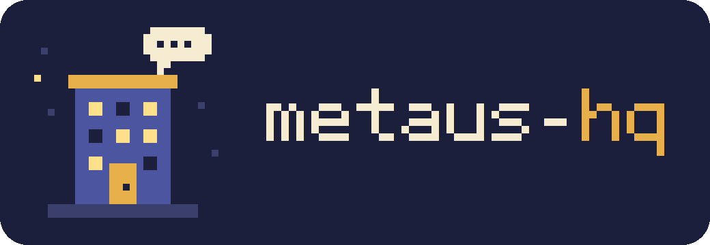

**Gamified squads. Human in the loop. Built in the open.**

---

## 🏢 Welcome to the HQ

**metaus-hq** is an ecosystem of software projects built by *squads*: small teams where humans and AI agents (powered by [Claude](https://claude.com)) plan, code and review together.

Everything lives inside a pixel-art office. Each squad has its own room, its own chat and a clear place for the human to step in, approve and steer.

## 🎮 How it works

- **Squads** — each project is run by a squad with defined roles.
- **Human in the loop** — agents propose and execute, humans decide at the key checkpoints.
- **Chat-first** — the first interface is a chat, with the office visuals growing on top of it.
- **Open by default** — projects, templates and conventions are published here on GitHub.

## 📦 Projects

| Repository | Description | Status |
|---|---|---|
| [`squad-template`](https://github.com/metaus-hq/squad-template) | Template repository to start any new squad project | 🚧 In progress |
| `office-chat` | Gamified chat where squads and humans talk | 🗓️ Planned |

## 🧭 Conventions

- Repository names in `kebab-case`
- Short description and standard topics on every repo
- Issue and PR templates shared from this `.github` repository
- English for READMEs, Portuguese welcome in discussions

## 🤝 Contributing

Ideas, issues and pull requests are welcome. Open an issue in the relevant repository, or start a discussion if you are not sure where your idea fits.

## 👤 Maintainer

Created by **Mateus** ([@mateusfilipe](https://github.com/mateusfilipe)), software developer based in Minas Gerais, Brazil.

---

🇧🇷 Leia em português

## 🏢 Bem-vindo ao HQ

**metaus-hq** é um ecossistema de projetos de software construídos por *squads*: pequenos times em que humanos e agentes de IA (com o [Claude](https://claude.com)) planejam, programam e revisam juntos.

Tudo acontece dentro de um escritório em pixel art. Cada squad tem sua sala, seu chat e um lugar claro para o humano entrar, aprovar e direcionar.

## 🎮 Como funciona

- **Squads**: cada projeto é conduzido por um squad com papéis definidos.
- **Humano no loop**: os agentes propõem e executam, os humanos decidem nos pontos-chave.
- **Chat primeiro**: a primeira interface é um chat, e o visual de escritório cresce em cima dele.
- **Aberto por padrão**: projetos, templates e convenções são publicados aqui no GitHub.

## 📦 Projetos

| Repositório | Descrição | Status |
|---|---|---|
| `squad-template` | Repositório-modelo para iniciar qualquer novo projeto de squad | 🚧 Em andamento |
| `office-chat` | Chat gamificado onde squads e humanos conversam | 🗓️ Planejado |

## 🤝 Contribuindo

Ideias, issues e pull requests são bem-vindos. Abra uma issue no repositório relacionado ou inicie uma discussão se não souber onde sua ideia se encaixa.

